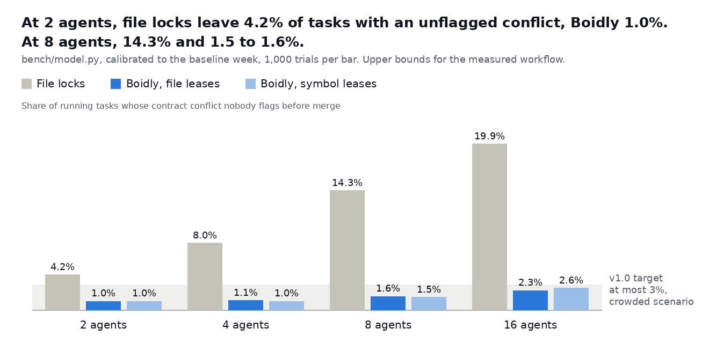
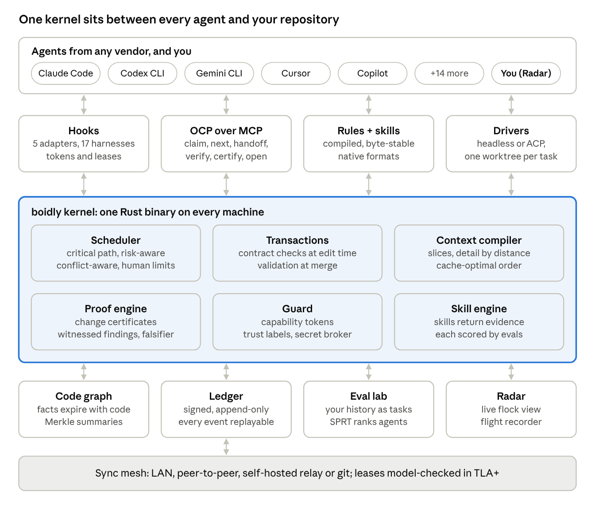
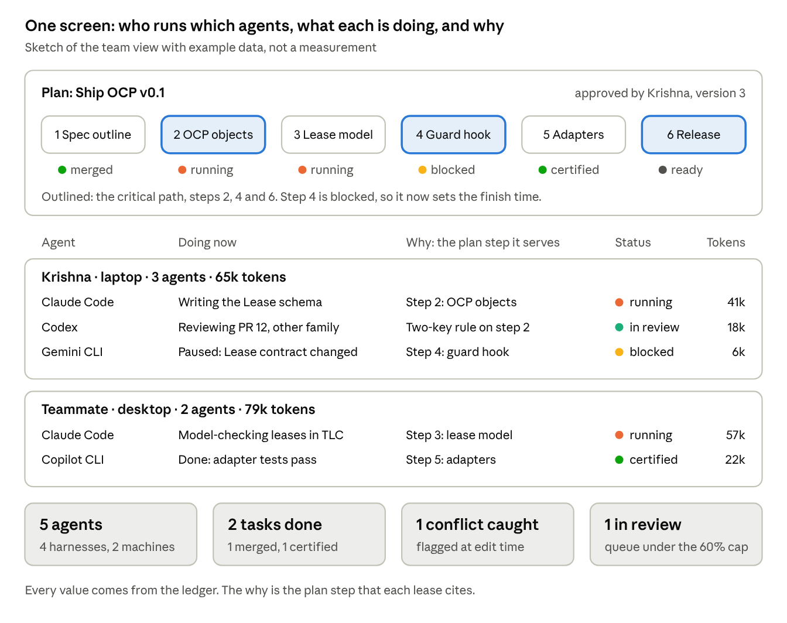

  <picture>
    <source media="(prefers-color-scheme: dark)" srcset="assets/boidly-logo-dark.svg">
    
  </picture>

<strong>Your agents, flying in formation.</strong>

  
  
  
  
  

Boidly builds open infrastructure that turns a crowd of AI coding agents into a team. Claude Code, Codex, Gemini CLI, Cursor, Copilot and the rest already work in the same repositories, and they fail together. In CooperBench, agents succeed about 30% less often working together than alone ([Khatua et al., 2026](https://arxiv.org/abs/2601.13295)). We are building the kernel that sits between all of them: one Rust binary, every major harness, no account, and an open protocol anyone can implement.

> [!NOTE]
> Boidly is in development. The blueprint, the logo and the model behind every number are written, and the first milestone, M0, passed its gate on 2026-10-23. The source repository is still private, and the first public release, v0.5, is planned for March 2027.

## What we are building

| | |
| --- | --- |
| **Boidly kernel** | A coordination kernel for AI coding agents. It schedules them, isolates them, gives them shared memory, and enforces permissions, the way an operating system does for programs |
| **Open Coordination Protocol (OCP)** | An open spec, with a conformance suite, that lets agents from any vendor work on the same code without breaking each other's work. MCP connects an agent to tools and A2A connects agents to agents. OCP coordinates their work on one codebase |
| **FlockBench** | An open benchmark for coordination itself: tokens, unflagged conflicts, time to finish, success, cost and human interventions, across vendors. Planned as a public platform at `bench.boidly.dev` |

## Why it matters

The numbers below come from a model anyone can rerun, not from a product yet. The model now takes today's workflow from a baseline week of real work, measured from its session logs. Boidly's own effects stay assumptions until they are measured.

| What we model | Today | With Boidly |
| --- | --- | --- |
| Contract conflicts nobody flags before merge, at the 2 agents of the baseline week | 4.2% of running tasks with file locks | 1.0% |
| The same at 8 agents | 14.3% | 1.5 to 1.6%. All four rates, with file locks and with Boidly, are upper bounds, because the model still crowds work more than the baseline week did |
| Cost of a task, against today's | 1.00 | 0.41 to 0.59, with review included at the top of the range. 0.64 to 0.68 in the conservative case. Lower than v0.3's range because the measured baseline carries far more context per call, while Boidly's compiled context keeps v0.3's size and Boidly's own effects are still assumed. 0.43 to 0.61 if that context grows with the files a task edits |
| Disagreeing tasks needed to rank two agents, when the stronger one wins 70% of disagreements | 76 with a fixed test | 43 on average with a sequential test |

## How it works

Agents never talk to each other directly. Everything they share passes through one kernel and lands in a ledger and a code graph, and a sync mesh carries the ledger to every machine.

Ten ideas carry the design:

| # | Idea | In one line |
| --- | --- | --- |
| 1 | Semantic transactions | File separation plus contract checks over a code graph of every live worktree, at plan, edit and merge time |
| 2 | The living code graph | Facts tied to the hashes of the code they were checked against, which expire when that code changes |
| 3 | The context compiler | Program slices and detail by distance, in a cache-stable layout, so agents read less |
| 4 | Proof-carrying changes | No certificate from the kernel, no merge. A finding blocks only with a witness, or when a second model family confirms it |
| 5 | The scheduler | Risk-aware list scheduling, capped parallel attempts, and human review as a hard limit |
| 6 | Repo-native evals | Your git history as a sealed private benchmark, ranked with two-sided sequential tests |
| 7 | A model-checked sync mesh | The lease protocol specified in TLA+, checked with TLC, and tested under deterministic simulation |
| 8 | Security by construction | Capability tokens, protected paths and a planner split, with hard guarantees in sandbox mode |
| 9 | Speed | A latency budget for every hot path, enforced in CI |
| 10 | Plans, the tracker and Radar | Turn a goal into a plan, track every task, and see who is doing what, why and at what cost |

## One screen for the whole team

Boidly turns a goal into a plan, tracks every task in it, and shows who runs which agents, what each one is doing, and why. The why is recorded, not guessed: every lease must cite the plan step it serves.

A design sketch with example data, not a measurement.

## Works with the agents you use

Before the public launch, every harness below gets its adapter at its highest level, passes a nightly conformance run, and has its benchmark numbers published.

| Level | What Boidly can do there | Harnesses |
| --- | --- | --- |
| L3 Driven | Launch the agent headless: scheduling, parallel attempts and repo-native evals | Claude Code, Codex CLI, Gemini CLI, Copilot CLI, Factory Droid, Qwen Code, Kiro, Goose, Cline, Devin CLI, OpenCode, Kilo Code, Amp |
| L2 Enforced | Block an edit before it lands: leases, capability tokens, edit-time contract checks | Cursor IDE and Cursor CLI, Copilot in VS Code, Copilot cloud agent |
| L1 Tools | Cooperate through MCP tools: ledger, context compiler, facts, findings | Zed agent, Warp, Devin cloud, Jules |
| L0 Rules | Compiled rules only | Aider |

Boidly speaks the standards agents already use: MCP, AGENTS.md, Agent Skills and ACP.

## Roadmap

Every gate is a measurement, not a date, so no phase can pass on effort alone. Work on the next phase may start while the gate above it is being measured, but no gate is judged before the gate above it passes. The dates were re-planned on 2026-10-27 from the measured pace of M0 and M1.

M1's engineering is planned to land by mid-November 2026. Its recorded two-week window of our own work runs in the second half of November, and its gate is judged around the end of November. M2's work starts during that window, and its gate is judged only after M1 passes, by the end of December.

| Phase | When (planned) | What ships | Gate to the next phase |
| --- | --- | --- | --- |
| M0 · Foundation | 20 to 23 Oct 2026, passed | Repository, brand, domains, OCP v0.1 and a TLA+ lease model, the cost model, a baseline week | Baseline measured, and the lease model passes TLC |
| M1 · Kernel | Oct to Nov 2026 | Ledger, guard hooks for Claude Code and Codex, worktree overlays, contract checks, `boidly status` | Two weeks of our own work with no unflagged contract conflict, and the guard within its latency budget |
| M2 · Context and proof | Nov to Dec 2026 | Context compiler, expiring facts, Merkle summaries, kernel-run certificates, merge queue, real-time ledger sync between machines through a self-hosted relay | 30% fewer tokens per verified task than the baseline, and no false done |
| M3 · Scheduler and evals | Jan 2027 | Conflict-aware picking, a human-review cap, an eval pilot with two-sided sequential tests, plans, the tracker and autopilot | At most 3% unflagged contract conflicts at 8 agents in FlockBench-lite |
| M4 · Public v0.5 | Feb to Mar 2027 | Every harness at its highest level, sandbox mode, protected paths, the team view, a basic Radar, `bench.boidly.dev` | Two agents synced in under 5 minutes on Windows, macOS and Linux, and every harness passes conformance |
| M5 · v1.0 | Apr to May 2027 | Relay sequencer, OCP 1.0 and its conformance suite, outside FlockBench submissions, latency budgets in CI | At most 0.6 of baseline tokens per verified task with review, and a second OCP implementation |
| After v1.0 | from Jun 2027 | Peer-to-peer mesh, Raft authority, A2A gateway, skill tuning, full Radar, an enterprise tier | |

## What we believe

- **Every number can be rerun.** A claim comes from a model in the repository, a measurement, or a cited source. A target is labeled as a target.
- **Proof over opinion.** A change merges with a certificate the kernel produced. A review finding blocks with a witness anyone can rerun.
- **Neutral across vendors.** No vendor will build coordination for its rivals' agents. An open protocol lets every one of them join.
- **Honest boundaries.** Hard security guarantees hold in sandbox mode, and everywhere else the docs say "defense in depth".
- **People are the scarcest resource.** Human review is planned as a capacity, not an afterthought.
- **Measure, then build.** Each phase ends at a gate, and every gate is a measurement.

## Get in touch

| | |
| --- | --- |
| General | hello@boidly.com |
| Security reports | security@boidly.com. Please report privately, never in a public issue. See [SECURITY.md](https://github.com/boidly/.github/blob/main/SECURITY.md) |
| Code of Conduct | [Contributor Covenant 2.1](https://github.com/boidly/.github/blob/main/CODE_OF_CONDUCT.md) |
| Websites | [boidly.com](https://boidly.com) for the product, [boidly.dev](https://boidly.dev) for developers, [bench.boidly.dev](https://bench.boidly.dev) for FlockBench |

## Support Boidly

Boidly is free and open source under Apache-2.0. If it helps you, you can support its development:

- **UPI**, for supporters in India: `krishankant962-6@okaxis`. The QR code is on [boidly.com/sponsor](https://boidly.com/sponsor/).
- **Buy Me a Coffee**, from anywhere: [buymeacoffee.com/krishnakrish0052](https://buymeacoffee.com/krishnakrish0052).
- **Companies** can write to hello@boidly.com.

## The name

Boidly comes from boids, Craig Reynolds' model of flocking, in which three simple local rules make many birds move as one ([Reynolds, 1987](https://doi.org/10.1145/37401.37406)). Boidly borrows the idea for coding agents: many of them, moving as one team. The logo is a lowercase b whose bowl is a ring that three boids fly around.

Boidly is licensed under Apache-2.0. The license does not grant rights to the Boidly name or logo.

